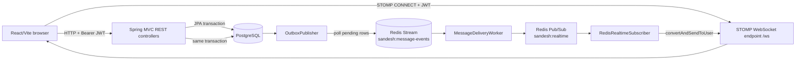
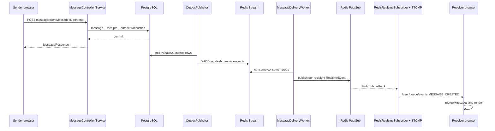
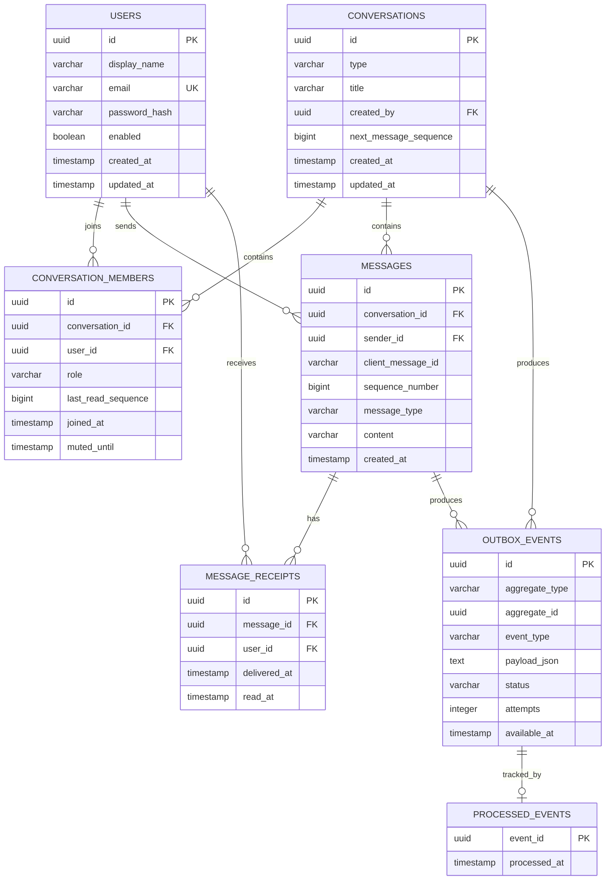
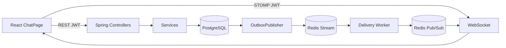

# Sandesh ko Samajhne ka Complete Learning Guide

> **Scope note:** Yeh document current repository implementation ko dekhkar likha gaya hai. Code, configuration ya database migrations badalne par is document ko bhi update karna hoga. Jahan behavior code se verify nahi ho saka, wahan usse clearly mark kiya gaya hai.

## Table of Contents

1. [Project ko samjho — big picture](#1-project-ko-samjho--big-picture)
2. [Architecture — andar se kaise bana hai](#2-architecture--andar-se-kaise-bana-hai)
3. [Directory structure](#3-directory-structure)
4. [Application start kaise hoti hai](#4-application-start-kaise-hoti-hai)
5. [Complete user journeys](#5-complete-user-journeys)
6. [Code execution ko deeply samjho](#6-code-execution-ko-deeply-samjho)
7. [Database deep dive](#7-database-deep-dive)
8. [Redis ka actual role](#8-redis-ka-actual-role)
9. [WebSocket aur real-time communication](#9-websocket-aur-real-time-communication)
10. [Security](#10-security)
11. [Errors, reliability aur edge cases](#11-errors-reliability-aur-edge-cases)
12. [Testing](#12-testing)
13. [Important engineering decisions](#13-important-engineering-decisions)
14. [Complete codebase learning map](#14-complete-codebase-learning-map)
15. [Resume aur interview preparation](#15-resume-aur-interview-preparation)
16. [Final mental model](#16-final-mental-model)

---

## 1. Project ko samjho — big picture

Sandesh ek real-time messaging application hai. User account banata hai, login karta hai, doosre users ko search karta hai, direct ya group conversation banata hai, messages bhejta hai, typing indicator dekhta hai, aur delivered/read status observe karta hai.

Simple language mein:

1. Browser mein React application load hoti hai.
2. Login ke baad backend JWT access token deta hai.
3. Browser REST APIs se conversations aur message history load karta hai.
4. Browser STOMP-over-WebSocket connection `/ws` par banata hai.
5. Message ka durable record PostgreSQL mein save hota hai.
6. Same database transaction mein outbox event save hota hai.
7. Background publisher outbox event ko Redis Stream mein daalta hai.
8. Delivery worker Stream ko consume karke Redis Pub/Sub channel par per-user event publish karta hai.
9. Redis subscriber event ko Spring user destination `/user/queue/events` par bhejta hai.
10. Frontend event receive karke apna React state update karta hai.

Isliye message ka “database mein save hona” aur “live screen par dikhna” alag concerns hain. PostgreSQL source of truth hai; Redis aur WebSocket fast delivery pipeline hain.

### Technology stack aur uska practical reason

| Layer | Technology | Is project mein practical role |
|---|---|---|
| UI | React 18 | Component-based chat screen aur state management |
| Routing | React Router | `/login`, `/register`, `/chat` aur protected/public routes |
| Build/dev server | Vite | Fast frontend development aur production bundle |
| REST client | Browser `fetch` | Auth, conversations, messages, receipts, search |
| Real-time client | `@stomp/stompjs` | STOMP CONNECT, user subscription, typing events |
| Backend | Spring Boot | HTTP controllers, validation, dependency injection, scheduling |
| Persistence | Spring Data JPA + PostgreSQL | Users, conversations, messages, receipts, outbox |
| Schema management | Liquibase SQL changelogs | Repeatable, ordered database migrations |
| Authentication | Spring Security + JJWT | Stateless Bearer JWT validation |
| Real-time broker | Spring WebSocket/STOMP | Browser connection aur user destinations |
| Cross-instance messaging | Redis Streams + Pub/Sub | Durable-ish event handoff aur live fan-out |
| Observability | Actuator + Micrometer Prometheus | Health endpoints aur delivery/outbox counters |

Yeh project sirf “WebSocket chat” nahi hai. Iska important design point hai: **REST durable command/query ke liye, outbox + Redis event delivery ke liye, aur WebSocket UI notification ke liye.**

---

## 2. Architecture — andar se kaise bana hai

### High-level architecture



**Arrows ka meaning:** Browser directly PostgreSQL ya Redis se baat nahi karta. REST controller command/query ko service tak le jaata hai. Message save aur outbox row ek transaction mein commit hone ke baad scheduled publisher Redis Stream ko feed karta hai. Worker event ko target user ke liye Redis Pub/Sub par bhejta hai. Subscriber us event ko connected STOMP user destination par forward karta hai.

### Backend layers

- **Controller:** HTTP/STOMP input boundary. Examples: [`AuthController`](../backend/src/main/java/com/aadi/sandesh/controller/AuthController.java), [`MessageController`](../backend/src/main/java/com/aadi/sandesh/controller/MessageController.java), [`ChatWebSocketController`](../backend/src/main/java/com/aadi/sandesh/controller/ChatWebSocketController.java).
- **DTO:** External request/response shape. Records jaise [`SendMessageRequest`](../backend/src/main/java/com/aadi/sandesh/dto/message/SendMessageRequest.java) validation annotations rakhti hain.
- **Service:** Business rules, transactions, membership authorization aur event creation. Examples: [`MessageService`](../backend/src/main/java/com/aadi/sandesh/service/MessageService.java), [`ConversationService`](../backend/src/main/java/com/aadi/sandesh/service/ConversationService.java).
- **Repository:** JPA queries aur locking. Examples: [`MessageRepository`](../backend/src/main/java/com/aadi/sandesh/repository/MessageRepository.java), [`ConversationRepository`](../backend/src/main/java/com/aadi/sandesh/repository/ConversationRepository.java).
- **Domain:** Database-mapped entities, sequence/receipt state transitions.
- **Messaging:** Outbox polling, Redis Stream consumption, Pub/Sub aur STOMP delivery.

### Communication boundaries

```mermaid
flowchart TB
    UI[ChatPage state]
    HTTP[api/httpClient.js]
    RESTAPI[/api/...]
    STOMP[stompClient.js]
    APP[/app/conversations/{id}/typing]
    USER[/user/queue/events]

    UI --> HTTP --> RESTAPI
    UI --> STOMP --> APP
    USER --> STOMP --> UI
```

Message send ke liye frontend REST POST use karta hai. Typing transient event hai, isliye STOMP application destination use hota hai. Incoming durable message, conversation update aur receipts backend-generated user destination se aate hain.

---

## 3. Directory structure

### Root

- [`backend/`](../backend): Spring Boot service, migrations, Docker dependencies.
- [`frontend/`](../frontend): React/Vite application, API clients, stores aur tests.
- [`docs/`](.): Existing architecture SVGs aur yeh learning document.

### Frontend

- [`frontend/src/main.jsx`](../frontend/src/main.jsx): React root, `StrictMode`, `BrowserRouter`.
- [`frontend/src/App.jsx`](../frontend/src/App.jsx): Route tree aur `AuthProvider`.
- [`frontend/src/auth/`](../frontend/src/auth): Login/register API, localStorage session aur context.
- [`frontend/src/routing/`](../frontend/src/routing): `ProtectedRoute` unauthenticated user ko login bhejta hai; `PublicOnlyRoute` logged-in user ko chat bhejta hai.
- [`frontend/src/pages/`](../frontend/src/pages): Login, register aur main [`ChatPage`](../frontend/src/pages/ChatPage.jsx).
- [`frontend/src/api/`](../frontend/src/api): Common fetch wrapper aur normalized `ApiError`.
- [`frontend/src/conversations/`](../frontend/src/conversations): Conversation REST functions aur identity/deduplication helpers.
- [`frontend/src/messages/`](../frontend/src/messages): Message REST functions, optimistic reconciliation aur client ID.
- [`frontend/src/realtime/`](../frontend/src/realtime): STOMP client aur event payload parsing.
- [`frontend/src/components/`](../frontend/src/components): Shell, dialogs, loading/error/connection UI.
- [`frontend/src/users/`], [`frontend/src/search/`], [`frontend/src/typing/`]: User search, message search aur typing indicator.
- [`frontend/src/*.test.js`](../frontend/src): Vitest unit tests for pure conversation/message state helpers.

Debugging rule: UI problem ho to pehle `ChatPage`, phir relevant API/store helper dekho. Network/auth problem ho to `httpClient`, `AuthProvider`, `authStorage` dekho. Live event problem ho to `stompClient`, backend WebSocket config, Redis subscriber aur event worker chain dekho.

### Backend

- [`backend/src/main/java/com/aadi/sandesh/config/`](../backend/src/main/java/com/aadi/sandesh/config): Security, CORS, Redis listener, STOMP endpoint.
- [`backend/src/main/java/com/aadi/sandesh/controller/`](../backend/src/main/java/com/aadi/sandesh/controller): REST aur WebSocket entry points.
- [`backend/src/main/java/com/aadi/sandesh/service/`](../backend/src/main/java/com/aadi/sandesh/service): Domain workflows.
- [`backend/src/main/java/com/aadi/sandesh/domain/`](../backend/src/main/java/com/aadi/sandesh/domain): JPA entities aur enums.
- [`backend/src/main/java/com/aadi/sandesh/dto/`](../backend/src/main/java/com/aadi/sandesh/dto): API/event contracts.
- [`backend/src/main/java/com/aadi/sandesh/repository/`](../backend/src/main/java/com/aadi/sandesh/repository): Database access.
- [`backend/src/main/java/com/aadi/sandesh/security/`](../backend/src/main/java/com/aadi/sandesh/security): JWT filter, principal aur current-user extraction.
- [`backend/src/main/java/com/aadi/sandesh/messaging/`](../backend/src/main/java/com/aadi/sandesh/messaging): Outbox aur Redis pipeline.
- [`backend/src/main/resources/application.yaml`](../backend/src/main/resources/application.yaml): Runtime configuration.
- [`backend/src/main/resources/db/changelog/`](../backend/src/main/resources/db/changelog): Liquibase master file aur ordered SQL migrations.

Generated `target/`, `node_modules/`, `dist/` aur compiled `out/` ko application samajhne ke liye ignore karna chahiye.

---

## 4. Application start kaise hoti hai

### Local infrastructure

[`backend/docker-compose.yaml`](../backend/docker-compose.yaml) PostgreSQL 16, Redis 7 aur optional pgAdmin start karta hai. PostgreSQL port `5432`, Redis `6379`, pgAdmin `5050` expose hote hain. Volumes data ko container restart ke baad preserve karte hain.

Typical order:

```text
backend: docker compose up -d
backend: ./mvnw spring-boot:run       (Windows: mvnw.cmd spring-boot:run)
frontend: npm run dev
```

Frontend ke exact development aur test commands [`frontend/README.md`](../frontend/README.md) mein hain. Actual secrets `.env` mein hone chahiye; `.env.example` templates hain.

### Spring Boot startup

Entry point [`SandeshApplication`](../backend/src/main/java/com/aadi/sandesh/SandeshApplication.java) `SpringApplication.run` call karta hai aur `@EnableScheduling` se outbox/delivery scheduled methods enable karta hai.

[`application.yaml`](../backend/src/main/resources/application.yaml) mein:

1. `SERVER_PORT` se HTTP port set hota hai.
2. Spring optional `.env` import karta hai.
3. Hikari datasource PostgreSQL se pool banata hai.
4. JPA `ddl-auto: validate` rakha gaya hai; Hibernate schema create nahi karta.
5. Liquibase `db.changelog-master.yaml` ko apply karta hai.
6. Redis host/port aur 2-second timeout configure hote hain.
7. JWT secret aur TTL load hote hain.
8. Allowed browser origins parse hote hain.
9. `/ws`, Redis channel, Redis stream aur rate limit settings load hoti hain.

Liquibase startup par changesets ko `DATABASECHANGELOG` bookkeeping ke through order mein apply karta hai. Uske baad Hibernate mapping ko existing schema se validate karta hai. Isliye database unavailable, migration failure ya schema mismatch application ko ready hone se rok sakta hai.

Spring context mein `SecurityConfig`, `WebSocketConfig`, Redis listener container, repositories aur scheduled workers create hote hain. `RedisConfig` Pub/Sub subscriber ko configured channel se bind karta hai. `MessageDeliveryWorker` Stream consumer group ko lazily initialize karta hai; stream banne se pehle worker retry-style polling karta rehta hai.

---

## 5. Complete user journeys

### 5.1 User application open karta hai

`main.jsx` React tree mount karta hai. `AuthProvider` ka initial state `authStorage.readSession()` se localStorage key `sandesh.auth` padhta hai. Expired ya malformed session clear ho jaata hai.

`App.jsx` route decide karta hai:

- session nahi hai: `/login` aur `/register` public; `/chat` `ProtectedRoute` se login par redirect.
- session hai: public routes `PublicOnlyRoute` se `/chat` par redirect.
- unknown path `/chat` par redirect.

Chat page mount hone par:

1. `listConversations(token)` se `/api/conversations` fetch hota hai.
2. pehli conversation active select hoti hai.
3. active conversation ka detail fetch hota hai.
4. `/messages?afterSequence=0` se latest page sync hoti hai.
5. `createRealtimeClient` STOMP connection activate karta hai.

### 5.2 Registration

Frontend [`RegisterPage`](../frontend/src/pages/RegisterPage.jsx) name, email aur 10–72 character password ka basic check karta hai. `authApi.register` POST `/api/auth/register` call karta hai.

Backend sequence:

```text
AuthController.register
  -> @Valid RegisterRequest
  -> AuthService.register
  -> existsByEmailIgnoreCase
  -> BCryptPasswordEncoder.encode
  -> UserAccountRepository.save
  -> JwtService.issue
  -> AuthResponse
```

`UserAccount` constructor email ko trim/lowercase karta hai aur enabled user banata hai. Password plaintext kabhi store nahi hota. Duplicate email `ConflictException` se `409 CONFLICT` banta hai. Response mein token, `Bearer`, expiry, user ID, display name aur email aata hai. Frontend ise localStorage mein save karke `/chat` par navigate karta hai.

### 5.3 Login

`LoginPage` `POST /api/auth/login` call karta hai. `AuthService.login` case-insensitive email se user dhundta hai, enabled flag aur BCrypt hash match verify karta hai. Missing user, disabled user aur wrong password sab generic “Invalid email or password” response dete hain, jisse account enumeration kam hoti hai.

JWT mein subject user UUID, `email`, issued-at aur expiration claims hote hain. Signing key `SANDESH_JWT_SECRET` se HMAC key banti hai. Frontend `expiresAt` ke basis par local logout timer lagata hai; API se 401 aane par common client `sandesh:unauthorized` event dispatch karta hai aur `AuthProvider` session clear karta hai.

### 5.4 Conversation list aur user search

`ChatPage.refreshConversations` `/api/conversations` se user ki memberships laata hai. Backend `ConversationService.list`:

- member ke basis par conversations query karta hai;
- latest message preview ke liye grouped query chalata hai;
- member display names/roles/last-read sequence bulk load karta hai;
- `ConversationResponse` banata hai.

Create dialog debounced `/api/users?q=...` search chalata hai. Direct create se pehle frontend `findDirectConversation` local list mein same two-member conversation dhundta hai. Backend bhi `findExistingDirectConversation` se duplicate direct conversation prevent karta hai; frontend check sirf UX optimization hai, security guarantee nahi.

### 5.5 Direct ya group conversation create karna

Create flow:

```text
CreateDialog
  -> createConversation()
  -> POST /api/conversations
  -> ConversationController.created
  -> ConversationService.create
  -> users validate
  -> Conversation + ConversationMember rows save
  -> group ke liye system message
  -> conversation outbox events
  -> ConversationResponse
```

Creator automatically member list mein add hota hai. Direct conversation exactly two members maangti hai; group minimum three. Creator `OWNER`, baaki `MEMBER` hote hain. Group creation ek system message create karti hai, jiska message event normal message pipeline se deliver hota hai. Conversation-created event har member ke liye separate outbox row banata hai.

### 5.6 User message bhejta hai

Yeh core journey hai.

1. Composer blank content ignore karta hai aur 4000 character limit rakhta hai.
2. Frontend UUID-style `clientMessageId` banata hai.
3. UI optimistic message ko `sending` status ke saath turant render karti hai.
4. `POST /api/conversations/{id}/messages` request jaati hai.
5. `MessageController.send` JWT principal se sender ID nikalta hai.
6. `MessageService.send` membership verify karta hai.
7. Same sender/client ID milne par idempotent existing response return hota hai.
8. Naye request par Redis rate limit check hota hai.
9. Recipient member IDs load hote hain.
10. Conversation row pessimistic lock ke saath load hoti hai.
11. `next_message_sequence` allocate hota hai.
12. `messages` row, recipient `message_receipts` rows aur `outbox_events` row ek transaction mein save hote hain.
13. HTTP response optimistic message ko server ID/sequence se replace karta hai.

Important code idea:

```java
var conversation = conversationRepository.findByIdForUpdate(conversationId)
        .orElseThrow(() -> new NotFoundException("Conversation not found"));
long sequenceNumber = conversation.allocateNextMessageSequence();
```

Lock ka purpose hai ki do concurrent sends ko same conversation sequence number na mile. Database unique constraint `(conversation_id, sequence_number)` second safety net hai.

### 5.7 Receiver ko live message milta hai

Message transaction ke baad pipeline:



Worker `MESSAGE_CREATED` event ke recipient IDs par loop karta hai. Sender ko is path se live copy nahi milti; sender ko POST response se canonical message milta hai. Receiver offline ho to WebSocket delivery miss ho sakti hai, lekin message PostgreSQL mein hai. Reconnect par frontend `sync()` cursor ke baad messages fetch karta hai.

### 5.8 Message history aur recovery

`syncMessages` `afterSequence` cursor bhejta hai. `MessageQueryService`:

- membership check karta hai;
- size ko 1–100 clamp karta hai;
- `afterSequence > 0` par ascending missed messages laata hai;
- initial load par latest messages descending query karke reverse karta hai;
- sender ke liye active member receipts se aggregate state resolve karta hai.

Frontend current messages ka maximum `sequenceNumber` cursor bana kar next sync karta hai. `syncRequest` counter stale response ko ignore karta hai, aur active conversation change hone par old response state overwrite nahi kar sakta.

### 5.9 Delivery aur read receipts

UI mein non-own message load hone par `ChatPage` `READ` acknowledgement POST karta hai. Backend [`ReceiptService`](../backend/src/main/java/com/aadi/sandesh/service/ReceiptService.java) membership, message aur user receipt verify karta hai.

- `DELIVERED`: sirf tab transition jab delivered/read dono absent hon.
- `READ`: `read_at` set hota hai aur `ConversationMember.last_read_sequence` monotonic update hota hai.
- repeated request no-op hoti hai.
- actual change par sender-targeted outbox `MESSAGE_DELIVERED` ya `MESSAGE_READ` event banta hai.

Sender state aggregate hai: current active recipients mein sab delivered nahi to `SENT`; sab delivered par sab read nahi to `DELIVERED`; sab read par `READ`. Removed member ke receipts ignore hote hain.

### 5.10 Typing indicator

Composer change par frontend `/app/conversations/{conversationId}/typing` publish karta hai; 1.2 seconds baad stop event. Backend `ChatWebSocketController.typing` JWT principal se actor ID leta hai aur `TypingService.update` membership verify karke baaki members ko direct Redis Pub/Sub realtime events bhejta hai.

Typing database/outbox mein persist nahi hota. Frontend receiver side 5-second expiry timer rakhta hai. Isliye typing best-effort transient signal hai, message history ka part nahi.

### 5.11 Group management aur leaving

Manager (`OWNER` ya role ke capability ke hisaab se admin) member add/remove aur group rename kar sakta hai. Har change:

- authorization check;
- domain/database update;
- human-readable system message;
- conversation update/removal event.

Member removal par removed user ko `CONVERSATION_REMOVED` milta hai, active members ko updated conversation. Permanent delete sirf group owner kar sakta hai; normal delete current user ki membership remove karta hai. Direct conversation member removal supported nahi hai.

### 5.12 Search

`GET /api/messages/search?q=...&size=...` sirf un conversations ke messages dikhata hai jahan current user member hai. Query lower-case `LIKE` based hai aur size 1–50 clamp hota hai. Yeh PostgreSQL substring search hai, full-text search index verified nahi hai.

---

## 6. Code execution ko deeply samjho

### REST authentication path

```text
HTTP request
 -> JwtAuthenticationFilter
 -> JwtService.parse(Bearer token)
 -> SecurityContext Authentication(ChatPrincipal)
 -> Controller Authentication parameter
 -> CurrentUser.id(authentication)
 -> Service authorization/business rule
```

Invalid token par filter context clear karta hai; protected endpoint Spring Security se 401 banata hai. `CurrentUser` aur [`ChatPrincipal`](../backend/src/main/java/com/aadi/sandesh/security/ChatPrincipal.java) typed user identity ko controller se service tak le jaate hain.

### Message send path ke important inputs/outputs

| Step | Input | Output/state change | Failure |
|---|---|---|---|
| Membership | conversation ID, sender ID | member confirmed | `403 FORBIDDEN` |
| Idempotency lookup | sender + client ID | existing response ya new send | content/conversation mismatch par `409` |
| Rate limit | sender ID | Redis/local counter | limit cross par `429` |
| Sequence lock | conversation ID | serialized sequence allocation | database error par transaction rollback |
| Message save | content, sender, sequence | durable `messages` row | rollback |
| Receipt save | recipients | one receipt per recipient | rollback |
| Outbox save | event JSON | delivery intent durable | rollback |
| Frontend merge | server response | optimistic row canonical row se replace | failed UI retry state |

### Event shape

[`RealtimeEvent`](../backend/src/main/java/com/aadi/sandesh/dto/event/RealtimeEvent.java) ke main fields `type`, `targetUserId`, `conversationId`, `actorUserId`, optional `messageId`, `payload`, `occurredAt` hain. Frontend `eventPayload` JSON string payload ko parse karta hai, although normal Jackson object payload bhi accept karta hai.

### Frontend reconciliation

`mergeMessages` map key ke liye server `id` ya `clientMessageId` use karta hai. Pehle matching `clientMessageId` optimistic row delete hoti hai; server row insert hoti hai; sequence number se sort hota hai. Isse REST response aur later realtime duplicate UI message nahi banate.

---

## 7. Database deep dive

### ER diagram



### Tables aur constraints

- `users`: identity, email uniqueness, BCrypt hash.
- `conversations`: direct/group type, title, creator aur per-conversation sequence allocator.
- `conversation_members`: membership, role, last-read cursor. `(conversation_id, user_id)` unique.
- `messages`: immutable message content, sender/client idempotency key aur conversation sequence. `(sender_id, client_message_id)` aur `(conversation_id, sequence_number)` unique.
- `message_receipts`: recipient-specific delivered/read timestamps. `(message_id, user_id)` unique.
- `outbox_events`: database commit ke saath durable event intent; pending/published/failed status, attempts/backoff.
- `processed_events`: worker idempotency marker.

Migrations [`001`–`013`](../backend/src/main/resources/db/changelog/) incremental history hain. Kuch early migrations audit, blocks aur device registration create karti hain, aur later migrations un unused schemas ko remove karti hain. Current Java model mein un removed tables ke entities nahi hain; isliye current runtime schema ko latest changelog sequence se samajhna chahiye, kisi ek early SQL file se nahi.

`MessageRepository` ka conversation+sequence index cursor sync aur latest-message query ko support karta hai. `OutboxRepository.findReadyForPublish` `FOR UPDATE SKIP LOCKED` use karta hai, jisse multiple publisher instances same ready row ko simultaneously claim karne ka risk kam hota hai.

### Transactions aur consistency

`@Transactional` message send mein message, receipts aur outbox ek atomic unit hain. Database commit ho gaya to delivery intent bhi commit hua; Redis unavailable hone par outbox pending rahega. `@Transactional(readOnly = true)` history/search ko write tracking se bachata hai. Receipt updates row lock ke saath monotonic transition ensure karte hain.

---

## 8. Redis ka actual role

### 8.1 Redis Stream: durable delivery handoff

Key/config: `sandesh:message-events`, consumer group `sandesh-delivery`.

Outbox publisher har 100 ms mein up to 100 ready rows padhta hai aur Stream record mein `eventId`, `eventType`, `payloadJson` likhta hai. Success par outbox `PUBLISHED`; failure par attempts increment, exponential backoff aur 10 attempts ke baad `FAILED`.

`MessageDeliveryWorker` consumer group se records consume karta hai. Invalid UUID/type ya malformed JSON ko poison pill maan kar acknowledge/dead-letter metric increment karta hai. Transient processing failure par acknowledge nahi karta, isliye pending message retry/recovery mein rehta hai. Five-second recovery:

- current consumer ke pending records process;
- doosre crashed consumer ke 30 seconds se idle records claim.

`processed_events` duplicate Stream delivery ko skip karne ka idempotency marker hai. Yeh **exactly-once** guarantee nahi, balki at-least-once processing ko duplicate-safe banane ka mechanism hai.

### 8.2 Redis Pub/Sub: live fan-out

Channel `sandesh:realtime` par `RedisRealtimePublisher` JSON event publish karta hai. `RedisRealtimeSubscriber` event parse karke:

```java
simpMessagingTemplate.convertAndSendToUser(
        event.targetUserId().toString(),
        "/queue/events",
        event
);
```

Pub/Sub replay nahi karta. Subscriber/backend ya receiver disconnected ho to live event lost ho sakta hai; PostgreSQL history + frontend reconnect sync recovery path hai.

### 8.3 Rate limit

Message send se pehle key `rate:message:{userId}:{epochMinute}` par Redis `INCR` hota hai. First increment par 2-minute expiry set hoti hai. Default 60 messages/minute. Redis `DataAccessException` par per-JVM `ConcurrentHashMap` fallback use hota hai; is fallback mein distributed instances ka global limit guarantee nahi hai.

Redis fail hone par:

- rate limit fallback locally continue kar sakta hai;
- outbox publisher log/retry karega;
- Stream worker read fail hone par return karega;
- Pub/Sub publish failure outbox-triggered paths mein retryable pipeline ko affect karega;
- typing event best-effort fail ho sakta hai.

---

## 9. WebSocket aur real-time communication

### HTTP vs WebSocket

HTTP request-response message send ke canonical response ke liye achha hai. Lekin receiver ko continuously poll karna expensive aur delayed hota. Isliye server-pushed events ke liye STOMP WebSocket use hua hai.

### Connection setup

Backend [`WebSocketConfig`](../backend/src/main/java/com/aadi/sandesh/config/WebSocketConfig.java):

- endpoint `/ws`;
- application prefix `/app`;
- user prefix `/user`;
- simple broker `/queue`, `/topic`;
- inbound channel par [`WebSocketAuthInterceptor`](../backend/src/main/java/com/aadi/sandesh/config/WebSocketAuthInterceptor.java).

Frontend `createRealtimeClient` `brokerURL` se connect karta hai, `Authorization: Bearer ...` STOMP CONNECT header bhejta hai, aur successful connect par `/user/queue/events` subscribe karta hai.

Interceptor sirf STOMP `CONNECT` par header validate karke `JwtService.parse` karta hai aur `ChatPrincipal` set karta hai. Typing handler baad mein `Principal` se user ID use karta hai. Endpoint HTTP security mein permit hai kyunki authentication STOMP CONNECT layer par hoti hai.

### Reconnect aur recovery

STOMP client 4 seconds se reconnect start karta hai, max delay 20 seconds. Reconnect hone par `ChatPage` conversations refresh aur message sync trigger karta hai. Isse Pub/Sub ke missed events cursor-based REST sync se recover ho jaate hain.

### Delivery semantics

- Database message persistence: transactional.
- Outbox handoff: retry/backoff based.
- Stream worker: consumer group + pending recovery, effectively at-least-once.
- `processed_events`: duplicate event processing guard.
- Redis Pub/Sub/WebSocket: live best-effort, replay nahi.
- UI ordering: server `sequenceNumber`.
- Offline receiver: message history mein available; reconnect sync se recover.

Current code mein explicit message delivery queue per browser, server-side offline push notification, or global deduplication of every Pub/Sub event verify nahi hota. Isliye “delivered” receipt ka meaning client ke REST acknowledgement tak pahunchna hai, sirf database mein receipt row ban jaana nahi.

---

## 10. Security

### Authentication

- Password `BCryptPasswordEncoder(12)` se hash hota hai.
- JWT stateless hai; server session nahi banata.
- Protected REST requests mein Bearer token required.
- STOMP CONNECT par same JWT verify hota hai.
- JWT secret environment variable `SANDESH_JWT_SECRET` se aata hai; source code mein secret nahi hai.

### Authorization

Spring Security authenticated endpoints protect karta hai. Domain-level membership [`MembershipService.requireMember`](../backend/src/main/java/com/aadi/sandesh/service/MembershipService.java) se enforce hoti hai. Manager actions `requireManager` se role capability check karte hain. Message search query member join ke through visible conversations tak restricted hai.

### Input/data safety

- Jakarta validation: email, string lengths, blank content, enum and UUID binding.
- JPA repository parameters/JPQL use hone se raw string SQL concatenation nahi hai.
- SQL `LIKE` search parameterized query ke through hai; SQL injection claim nahi banana chahiye ki arbitrary query safe hai, but repository code injection-prone concatenation nahi karta.
- CORS explicit origins se configure hai; `AllowedOrigins` wildcard `*` reject karta hai.
- Error responses stacktrace/message inclusion disable karte hain at framework level; unexpected exception generic 500 response aur server log deta hai.

### Security limitations to understand

JWT browser `localStorage` mein store hota hai. Isse HttpOnly cookie ke mukable XSS exposure trade-off aata hai; current code mein CSP/refresh-token rotation verify nahi hai. CSRF disabled hai because API stateless Bearer model use karti hai, lekin token theft prevention ka burden frontend security par rahta hai.

---

## 11. Errors, reliability aur edge cases

`GlobalExceptionHandler` consistent `ApiError` response deta hai:

```json
{
  "status": 400,
  "code": "VALIDATION_ERROR",
  "message": "Validation failed for one or more fields",
  "path": "/api/...",
  "violations": []
}
```

Important mappings:

- invalid/missing auth: `401 UNAUTHORIZED`;
- non-member/insufficient role: `403 FORBIDDEN`;
- missing resource: `404 NOT_FOUND`;
- idempotency/content conflict: `409 CONFLICT`;
- message rate limit: `429 RATE_LIMIT_EXCEEDED`;
- malformed JSON/type mismatch/validation: `400`;
- unexpected server exception: logged + generic `500`.

Frontend `httpClient` network error ko `ApiError` banata hai, 401 par auth event dispatch karta hai, aur `errorMessage` status ke hisaab se user-friendly message deta hai.

### Failure behavior matrix

| Situation | Actual behavior |
|---|---|
| Invalid form | Frontend submit se pehle local message |
| Invalid backend input | Bean validation + `400` |
| Duplicate direct conversation | Existing direct conversation return |
| Duplicate message retry | Same `clientMessageId` ka existing response |
| Same client ID with different content | `409` |
| Receiver offline | DB message remains; reconnect sync |
| WebSocket close | STOMP reconnect; status UI update |
| Redis Stream unavailable | Worker logs and retries later |
| Outbox publish fail | exponential retry, max 10 attempts |
| Worker transient fail | Stream record unacknowledged |
| Poison event | acknowledge/dead-letter metric, blocking avoid |
| Repeated receipt | monotonic no-op |
| Concurrent send | conversation pessimistic lock + unique sequence |

Potential improvements ko implemented behavior se alag rakho: automatic outbox cleanup, dead-letter replay UI, richer retry telemetry, pagination UI for older-than-latest history, and stronger client-side security current code mein fully verify nahi hain.

---

## 12. Testing

Visible automated tests frontend mein hain:

- [`apiError.test.js`](../frontend/src/api/apiError.test.js): API error normalization.
- [`conversationStore.test.js`](../frontend/src/conversations/conversationStore.test.js): direct identity, upsert aur deduplication.
- [`messageStore.test.js`](../frontend/src/messages/messageStore.test.js): optimistic/server reconciliation aur sequence ordering.
- [`test/setup.js`](../frontend/src/test/setup.js), [`fixtures.js`](../frontend/src/test/fixtures.js): Vitest/jsdom support.

Commands:

```bash
cd frontend
npm test
npm run build
```

Backend Maven project mein test source files current source inventory mein visible nahi the. Isliye backend transaction, controller, WebSocket aur Redis integration behavior ko existing application tests se verified claim nahi karna chahiye. Practical manual test plan:

1. PostgreSQL/Redis start karke registration/login.
2. Do browser sessions se direct conversation.
3. Message send, refresh, reconnect aur offline receiver.
4. Group create/add/remove/rename.
5. Receipt transitions aur duplicate receipt calls.
6. Redis stop karke outbox retry/logs observe.
7. Invalid JWT, non-member URL aur validation payloads.

Tests ko code learning tool ki tarah padho: pure store tests backend ke complex event timing ko isolate karke frontend reconciliation contract clarify karte hain.

---

## 13. Important engineering decisions

### REST + WebSocket, sirf WebSocket nahi

**Choice:** commands/history REST; live notifications STOMP.  
**Reason:** REST retryable, inspectable aur history query ke liye natural hai. WebSocket server push ke liye efficient hai.  
**Alternative:** all-WebSocket command protocol ya polling. All-WebSocket mein persistence/error semantics complex hote; polling latency aur load badhata.  
**Trade-off:** do protocols aur do authentication surfaces maintain karne padte hain.

### PostgreSQL source of truth

**Choice:** users, memberships, messages, receipts PostgreSQL mein.  
**Reason:** relational constraints, transactions, queries aur durable history.  
**Alternative:** Redis-only chat fast hoti par durable relational history/constraints weak hote.  
**Trade-off:** database round trips aur schema migrations ka operational cost.

### Transactional outbox

**Choice:** message ke saath outbox row same transaction mein.  
**Reason:** message commit ho gaya lekin event publish nahi hua wali dual-write gap ko avoid karna.  
**Alternative:** database commit ke baad direct Redis publish; crash window mein live notification lost.  
**Limitation:** outbox publisher asynchronous hai, isliye live event immediate nahi guaranteed.

### Redis Stream + Pub/Sub

**Choice:** Stream durable handoff, Pub/Sub low-latency fan-out.  
**Reason:** consumer groups/pending recovery Stream mein; WebSocket delivery ke liye simple channel.  
**Trade-off:** Pub/Sub replay nahi karta, isliye reconnect sync required. Redis operational dependency bhi hai.

### Client message ID

**Choice:** frontend-generated `clientMessageId`.  
**Reason:** retry ko duplicate message banne se rokna aur optimistic row ko canonical response se reconcile karna.  
**Trade-off:** client ko ID generate/preserve karni padti hai; server same ID ko different content ke liye reject karta hai.

### Conversation sequence instead of timestamp ordering

**Choice:** locked `next_message_sequence`.  
**Reason:** concurrent sends mein deterministic order aur cursor recovery.  
**Trade-off:** har message send conversation row ko lock karta hai, high-contention conversation throughput limit ho sakta hai.

### Aggregate receipts

**Choice:** sender ko all active recipients ka aggregate `SENT/DELIVERED/READ`.  
**Reason:** group chat mein single compact status. Removed members ko exclude karke current membership semantics rakhi gayi.  
**Trade-off:** sender ko per-recipient detail nahi milti.

---

## 14. Complete codebase learning map

1. **UI bootstrap:** `frontend/src/main.jsx`, `App.jsx`, routing. Samjho React tree aur auth gates.
2. **Auth:** `AuthProvider`, `authStorage`, `authApi`, `AuthController`, `AuthService`, `JwtService`. Samjho token lifecycle.
3. **HTTP contract:** `httpClient`, `apiError`, DTO records aur `GlobalExceptionHandler`.
4. **Conversation UI:** `ChatPage`, `conversationApi`, `conversationStore`, `ConversationController`, `ConversationService`.
5. **Data model:** `Conversation`, `ConversationMember`, `UserAccount`, `Message`, `MessageReceipt`.
6. **Message command:** `messageApi`, optimistic `send`, `MessageController`, `MessageService`, repositories.
7. **Message query:** `MessageQueryService`, sequence cursor, `mergeMessages`.
8. **Receipts:** `ReceiptService`, `MessageReceiptStateService`, UI acknowledgement.
9. **Realtime:** `stompClient`, `WebSocketConfig`, `WebSocketAuthInterceptor`, typing service.
10. **Reliability pipeline:** `OutboxEvent`, `OutboxPublisher`, `MessageDeliveryWorker`, `RedisRealtimePublisher/Subscriber`.
11. **Database:** master changelog ko 001 se 013 tak padho, phir repository queries ko schema indexes se match karo.
12. **Failure paths:** rate limit, retries, pending claims, exception handler aur frontend retry UI.
13. **Validation:** frontend Vitest tests, then manual two-browser and Redis failure exercises.

Har step par yeh sawaal poochho: input kaun deta hai, transaction boundary kahan hai, authorization kahan hai, durable state kya hai, event ka target kaun hai, aur failure ke baad recovery kaise hoti hai?

---

## 15. Resume aur interview preparation

### Confident technical claims

- “I built a React + Spring Boot real-time messaging system.”
- “Messages are persisted in PostgreSQL through JPA and delivered through a transactional outbox.”
- “The delivery pipeline uses Redis Streams with consumer groups and pending-message recovery.”
- “Live browser events use authenticated STOMP destinations over WebSocket.”
- “Message retries are idempotent through sender-scoped client message IDs.”
- “Conversation sequence numbers and pessimistic locking provide deterministic cursor-based synchronization.”
- “Receipt state is aggregated across active conversation members.”
- “JWT authentication is stateless and passwords are BCrypt-hashed.”

### Claims ko qualify karna

“Exactly-once delivery”, “guaranteed offline push”, “full-text search”, “multi-region availability”, “complete backend test coverage” ya “end-to-end encryption” claim na karo; current code se yeh guarantees verify nahi hoti.

### Likely questions aur strong answer points

1. **Message duplicate kaise rokoge?**  
   `clientMessageId`, `(sender_id, client_message_id)` uniqueness, existing message return, mismatch par conflict.
2. **Outbox kyu?**  
   Message + event intent same DB transaction; asynchronous Redis publish crash gap ko reduce karta.
3. **Redis down ho to message?**  
   PostgreSQL transaction successful ho sakti hai; outbox pending/retry. Typing live signal lose ho sakta, receiver reconnect sync kar sakta.
4. **WebSocket auth kaise?**  
   REST filter HTTP Bearer parse karta; STOMP CONNECT interceptor native Authorization header parse karke Principal set karta.
5. **Group receipt READ kab?**  
   Current active recipients ke sab receipts read hone par sender aggregate `READ`; removed member exclude.
6. **Concurrent messages order?**  
   Conversation row `PESSIMISTIC_WRITE` lock aur `next_message_sequence`.
7. **Offline receiver ko message kaise milega?**  
   DB history remains; reconnect event handler `sync()` cursor se missed messages fetch karta.
8. **Redis Stream aur Pub/Sub mein difference?**  
   Stream consumer-group/pending recovery ke liye; Pub/Sub low-latency fan-out ke liye but replay nahi.
9. **Security limitation?**  
   JWT localStorage mein hai, so XSS risk trade-off; explicit CORS aur BCrypt present, but stronger browser hardening further work ho sakti hai.
10. **Search kaise authorize hota hai?**  
    JPQL query `ConversationMember` join ke through current user ke visible conversations tak messages limit karti hai.

---

## 16. Final mental model

### One-paragraph revision

Sandesh ek React/Vite frontend aur Spring Boot backend wala messaging system hai. Login ke baad browser JWT ko localStorage mein rakhta hai, REST se conversations/history load karta hai aur authenticated STOMP WebSocket subscribe karta hai. Message REST request se aata hai; backend membership, idempotency, rate limit aur sequence lock ke baad PostgreSQL mein message, receipts aur outbox event ko ek transaction mein save karta hai. Scheduled outbox publisher Redis Stream ko feed karta hai, delivery worker event ko per-user Redis Pub/Sub message banata hai, aur Redis subscriber STOMP `/user/queue/events` se browser tak bhejta hai. Reconnect par sequence cursor se PostgreSQL sync live Pub/Sub ke missed events recover karta hai.

### Compact architecture



### Component responsibilities

- React: user interaction, optimistic UI, session and reconnect sync.
- REST controllers: request boundary and response status.
- Services: business rules, authorization, transactions.
- PostgreSQL/JPA: durable relational state.
- Liquibase: ordered schema evolution.
- Outbox: durable event intent.
- Redis Stream: asynchronous delivery queue.
- Delivery worker: parse, route, retry/recover, deduplicate.
- Redis Pub/Sub: low-latency cross-instance fan-out.
- STOMP/WebSocket: browser push channel.
- Receipts: recipient progress and aggregate sender status.

### Must-understand concepts

JWT stateless auth, BCrypt, Spring Security filter chain, STOMP destinations, user destinations, JPA transactions, pessimistic locking, optimistic UI, idempotency key, cursor pagination, transactional outbox, Redis Streams consumer groups, Pub/Sub non-replay semantics, monotonic receipt state, CORS, Liquibase migrations, and failure recovery.

### Glossary

- **Authentication:** “Tum kaun ho?” — JWT se identity prove karna.
- **Authorization:** “Tum yeh action kar sakte ho?” — membership/role check.
- **Bearer token:** Request header mein diya gaya access token.
- **STOMP:** WebSocket messages ko destinations aur commands ke form mein organize karne wala protocol.
- **User destination:** `/user/queue/events`; server specific user ke connections ko event bhejta hai.
- **Outbox:** Main data transaction ke saath save hua pending event record.
- **Idempotency:** Same retry ko repeat karne par duplicate side effect na ho.
- **Sequence cursor:** Last received message number; uske baad ke messages sync karne ka checkpoint.
- **Consumer group:** Redis Stream consumers ka coordinated group.
- **Pub/Sub:** Publish-subscribe live channel; old messages replay nahi hote.
- **Receipt:** Kisi recipient ko message delivered/read hua ya nahi.
- **Pessimistic lock:** Concurrent transaction ko row par wait karwana.
- **Optimistic UI:** Server response ka wait kiye bina expected result render karna.
- **Dead letter:** Invalid/poison event jo normal retry loop ko block na kare.
- **CORS:** Browser origin ko backend se request karne ki permission policy.
- **Migration:** Database schema ko versioned, repeatable changes ke through evolve karna.

